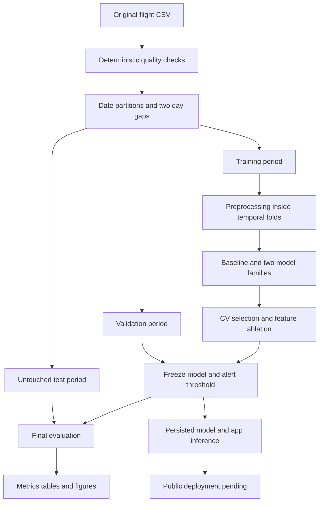

# Implemented Python workflow

Missing numerical predictors are imputed using training-only medians. Category encoders, scaling and model fitting are also confined to the training side of each fold. The validation period selects the alert threshold. Test labels do not choose models, hyperparameters, feature variants or thresholds.

This diagram documents the actual Python implementation. It is not a RapidMiner execution screenshot or a RapidMiner process file.
