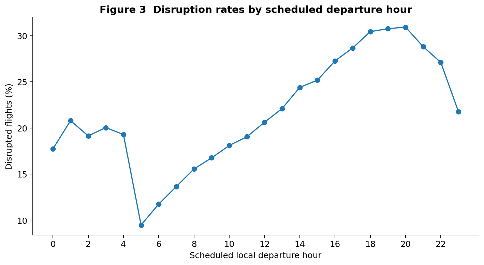
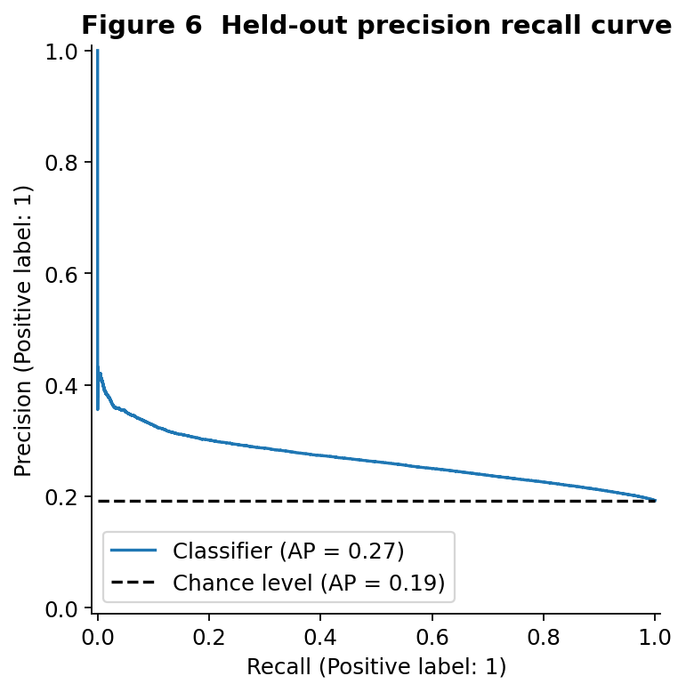

# Flight Disruption Prediction and Passenger-Support Planning

A Python data science project that uses historical flight schedules to estimate disruption risk and prioritize a limited passenger-support review workload. The analysis covers **5,819,079 US domestic flight records with 31 original columns** from 2015 and compares a prevalence baseline with two machine learning approaches.

**Repository:** [Celestica19/cds4003-flight-disruption](https://github.com/Celestica19/cds4003-flight-disruption)  
**Live application:** Deployment pending; a public application URL is not yet available.  
**Technical status:** Data preparation, model fitting, held-out evaluation, six notebook executions and saved-model inference checks are complete. Streamlit interface execution and public deployment still require verification.

## Business problem and objectives

Passenger-support teams have limited time to identify flights that may need additional attention. A schedule-based risk ranking could help allocate review capacity before departure, supporting preparation for passenger communication and assistance. Intended users are support planners and service managers.

The task is binary classification. A flight is **disrupted** when it is cancelled, diverted, or arrives at least 15 minutes late. A flight with a known arrival outcome below that threshold, and neither cancellation nor diversion, is **not disrupted**. Missing arrival outcomes are not automatically interpreted as on-time flights.

The project evaluates three measurable objectives within the fixed 2015 study period:

1. Audit all source records, reconcile the resulting partitions and document missingness, duplicates, inconsistent identifiers and extreme values.
2. Compare two model families against a prevalence baseline using chronological validation and mean cross-validation average precision.
3. Evaluate whether reviewing the highest-ranked 10% of November–December flights achieves at least **1.25× lift** over random selection, while reporting precision, missed disruptions and workload.

Machine learning is suitable because calendar, carrier and schedule characteristics may have nonlinear relationships with disruption risk. Baseline comparison checks whether model complexity provides useful predictive information. The observed test lift is **1.604×**, measuring historical prioritization performance rather than demonstrated financial savings or intervention effectiveness.

## Project scope

The workflow covers source acquisition, quality assessment, preparation, exploratory analysis, feature engineering, model comparison, tuning, evaluation and an application for reviewing predictions. Predictors use planned information: airline, origin, destination, service date, scheduled local departure and arrival times, distance and scheduled duration.

The model supports an individual-flight priority based on a fixed validation threshold and a ranked batch list constrained by review capacity. This is a **historical decision-support demonstration**. It does not use live weather, current airport congestion, passenger bookings or real-time tracking. It does not predict exact delay minutes, diagnose disruption causes or automate dispatch and passenger-entitlement decisions. Applying it to another year or geography would require new data and validation.

## Contributors and responsibilities

| Contributor | Contribution |
|---|---|
| [Celestica19](https://github.com/Celestica19) | Project research, provision of the original dataset archive, GitHub repository creation and file upload, and review of project scope and documentation. |
| Additional team members | Names, GitHub profiles and actual responsibilities have not yet been supplied. |

Full team names and individual implementation or analysis contributions should be expanded with specific file or commit links as those contributions are confirmed. Technical assistance is acknowledged below.

## Dataset and access

| Item | Details |
|---|---|
| Dataset | [2015 Flight Delays and Cancellations](https://www.kaggle.com/datasets/usdot/flight-delays) |
| Source attribution | US Department of Transportation, Bureau of Transportation Statistics, as identified by the Kaggle dataset page |
| Published dataset licence | CC0: Public Domain |
| Main file | `flights.csv`: 5,819,079 rows and 31 columns |
| Supporting files | `airlines.csv` and `airports.csv` |
| Coverage | US domestic reporting-carrier flights during 2015 |
| Data types | Numerical measures, categorical identifiers, calendar fields, clock times and outcome indicators |
| Repository samples | A 1,000-row source sample and a 20-row application input example |

The dataset suits the problem because schedules can be separated from observed outcomes, dates support temporal validation, and its volume supports carrier and schedule comparisons. The 31 source columns support auditing and target construction; only information available before departure is eligible as a predictor.

Obtain the original archive from the source page or use `scripts/download_data.py`. Full raw and processed datasets are excluded from Git. Keep original CSV files unchanged. Source hashes and counts are recorded in the [download manifest](reports/download_manifest.json) and [quality audit](reports/quality_audit.json).

See the [data dictionary](docs/data_dictionary.csv), [dataset-search record](docs/dataset_search.csv) and [references](docs/references.md) for definitions, source comparisons and supporting links. Historical carrier coverage and geography limit generalization.

## Data preparation and quality decisions

Preparation processes the full source in chunks and uses a disk-backed index for duplicate checks across chunk boundaries. All **5,819,079** records were retained. No exact duplicates, conflicting business-key records or quarantined rows were found.

| Quality issue | Observed evidence and treatment | Reason |
|---|---|---|
| Missing arrival delay | 105,071 missing values; cancellation and diversion indicators determine the target where appropriate | An absent outcome is not evidence of an on-time arrival. |
| Missing planned duration | Six training values; the final fitted training median is 122 minutes | Keep usable records with imputation learned within training folds. |
| Missing delay causes and cancellation reasons | Structural absence is retained in audit data | Zero-filling would impose unsupported meaning; these fields are excluded from predictors. |
| Mixed airport identifiers | 486,165 numeric origins and the same number of numeric destinations in October; preserved with a `BTS_` prefix | Avoid guessed IATA mappings. Identity reconciliation remains unresolved. |
| Negative arrival delay | 3,500,899 values retained | Negative delay represents valid early arrival. |
| Extreme positive arrival delay | 32 values above 1,440 minutes retained | Rare severe disruption is relevant; magnitude alone does not establish an error. |
| Midnight representation | Two scheduled arrival values use `2400`; converted to midnight for features | Handle a valid clock convention explicitly. |
| Types, ranges and duplicates | Full-file numeric, calendar, clock, categorical and duplicate checks with recorded counters | Preserve evidence even when a check finds no errors. |

Numerical imputation, scaling where used and categorical encoding are fitted within each training fold. Final preprocessing was checked across all 3,888,115 training rows and left no missing numerical model inputs. Structural outcome missingness remains in audit data by design.

The [decision record](docs/technical_decisions.md), [before/after missingness](reports/missingness_before_after.csv), [imputation evidence](reports/model_input_imputation.csv) and [outlier review](reports/outlier_review.csv) document the rules and effects.

## Exploratory analysis and features

EDA uses the training period for carrier, departure-hour and daily disruption summaries. Full-data missingness describes source quality. A reproducible 100,000-row training sample supports the arrival-delay distribution and descriptive statistics; chart display limits do not remove records from modelling.

Training disruption rates rise from **11.74% at 06:00–06:59** to **30.93% at 20:00–20:59**. This supports investigating schedule-related risk when planning review capacity. Charts also examine carrier differences and temporal variation. Carrier differences may reflect route mix and operating conditions; they do not isolate carrier performance or identify causes.



*Figure 1. Disruption rates by scheduled departure hour, using all training records with valid scheduled departure time. The relationship is descriptive, not causal.*

The base set contains nine predictors: departure minute, arrival minute, distance, scheduled duration, month, weekday, airline, origin and destination. The extended set adds cyclic sine/cosine encodings, weekend and late-departure indicators, log distance, scheduled miles per hour, numeric-airport-ID flags and route categories. Scheduled miles per hour is a gate-to-gate schedule proxy, not measured airborne speed.

A fixed-parameter ablation compares the sets on the same temporal folds. Extended-minus-base mean average precision is **−0.000386**. The base set was retained because it scored slightly higher; the small difference does not establish strong superiority. Validation permutation importance ranks scheduled departure time highest, followed by destination. Importance describes global predictive association, not individual-flight causation.

All ten labelled figures appear in the [results evidence page](reports/results_evidence.html), with [captions](reports/figure_captions.json).

## Model development and evaluation

### Chronological partitions

| Partition | Dates in 2015 | Records | Purpose |
|---|---|---:|---|
| Training | 1 January–29 August | 3,888,115 | Development and final fitting |
| Validation | 1 September–29 October | 923,321 | Threshold selection and diagnostics |
| Test | 1 November–31 December | 947,202 | Final held-out evaluation |
| Embargo | 30–31 August and 30–31 October | 60,441 | Separation between partitions |

Within training, expanding folds validate on April, June and August with a two-day gap. Tuning uses a fixed-seed 120,000-row training sample for efficiency. Final fitting uses **all eligible training rows**; validation and test scoring are uncapped. The gap reduces immediate dependence but cannot remove all seasonal or route dependence.

A predictor allowlist excludes actual departure and arrival outcomes, delay causes and tail assignments. Preprocessing is learned within folds. Model and feature selection precede validation-threshold freezing and final test evaluation.

### Models and tuning

| Model | Rationale | Mean CV average precision before tuning | After tuning |
|---|---|---:|---:|
| Prevalence baseline | Performance without schedule-based discrimination | 0.2115 | 0.2115 |
| Logistic regression fitted with SGD | Scalable linear model, standardized numerical inputs and one-hot categories | 0.2893 | 0.3021 |
| Histogram gradient boosting | Nonlinear patterns and interactions, with native categorical handling | 0.3016 | 0.3077 |

Each nonbaseline model receives a six-candidate randomized search on the same folds. Logistic tuning covers regularization, penalty and class weighting. Boosting tuning covers learning rate, leaf count, minimum leaf size and L2 regularization. [Search spaces](reports/search_spaces.json) and complete search results are included.

Histogram gradient boosting had the highest tuned mean CV average precision. Subsequent ablation selected its base-feature variant, with mean CV average precision **0.3081**. The tuning table and ablation describe separate comparisons; ablation is not a separately retuned search.

Average precision is primary because the task ranks a minority positive class. Evaluation also includes ROC AUC, precision, recall, F1, confusion counts, Brier score, log loss, workload, subgroups and day-cluster bootstrap intervals. A false-positive/false-negative cost ratio of 1:5 is an illustrative sensitivity assumption, not a measured airline cost.

## Results and business interpretation

| November–December test measure | Selected model | Prevalence baseline |
|---|---:|---:|
| Flights evaluated | 947,202 | 947,202 |
| Average precision | 0.2663 | 0.1926 |
| ROC AUC | 0.6171 | 0.5000 |
| Brier score; lower is better | 0.1526 | 0.1563 |
| Precision among highest-ranked 10% | 30.89% | 19.20% |
| Recall among highest-ranked 10% | 16.04% | 9.97% |
| Lift at 10% review capacity | 1.604× | 0.997× |

The baseline assigns equal scores and uses outcome-independent tie-breaking. Its finite-sample lift is close to, rather than exactly, one.

At 10% capacity, approximately **31 of every 100 prioritized flights** were disrupted, compared with 19 under baseline selection. This provides a more concentrated historical review queue. However, it captures only **16.04% of all disruptions**; most disruptions remain outside the queue.



*Figure 2. November–December precision–recall performance after model selection and threshold freezing. Average precision is reported separately from the plotted curve.*

The fixed validation threshold of **0.327878** flagged **12.19%** of test flights, exceeding nominal workload. Batch ranking instead selects the requested fraction of a schedule, rounded down to whole flights. A real-data check selected exactly **100 of 1,000 flights** at 10% capacity.

Evidence: [test metrics](reports/test_metrics.json), [model comparison](reports/model_comparison.csv), [threshold sensitivity](reports/validation_threshold_sensitivity.csv), [subgroup results](reports/test_subgroup_metrics.csv) and [model card](models/model_card.md).

## Application functionality

The Streamlit application provides:

- An individual-flight form with airline and airport names, historical date, local schedule times, distance and duration.
- Input validation, including same-airport rejection and observed numerical-range checks.
- A disruption probability estimate and priority message under the selected threshold.
- Batch CSV ranking for up to 50,000 flights, adjustable capacity and a downloadable review list.
- Held-out performance, global feature importance and scope information.

Use the [example schedule](data/sample/app_example.csv) for the batch schema. Dates are limited to 2015. Local arrival and departure clocks can use different time zones, so duration is supplied separately.

## Installation and local use

Use **Python 3.12**, matching the analysis run, and run commands from the project root. Core dependencies are pinned in [requirements.txt](requirements.txt); Streamlit has a bounded version range. The analysis used Python 3.12.14; see [environment versions](reports/environment_versions.json).

Create a virtual environment:

```bash
python -m venv .venv
```

Activate it on Windows Command Prompt:

```bat
.venv\Scripts\activate.bat
```

Or on macOS/Linux:

```bash
source .venv/bin/activate
```

Install dependencies and launch the included trained model:

```bash
python -m pip install -r requirements.txt
python -m unittest discover -s tests -v
python -m streamlit run app/streamlit_app.py
```

Raw data and retraining are not required to launch the included model. Recorded validation includes **18 passing software tests**, agreement between 1,000 saved-model predictions and evaluation outputs, training-input imputation checks and a real-data batch-capacity check. Streamlit could not be installed in the analysis environment, so interface execution and public deployment remain unverified.

## Reproducing the analysis

In a fresh analysis workspace, obtain the source data:

```bash
python scripts/download_data.py
```

If browser download is needed, import the archive instead:

```bash
python scripts/download_data.py --archive /path/to/flight-delays.zip
```

With all three original CSVs in `data/raw/`, run:

```bash
python scripts/run_pipeline.py --skip-download
```

This runs preparation, training, artifact verification, chart generation and evidence generation. Budget approximately 16 GB RAM and 10 GB free disk space for a full run; actual needs vary. Seeds, dates and tuning limits are in [config.json](config.json).

**Existing test results are protected:** training refuses to overwrite a recorded test evaluation. Use a fresh workspace for reproduction. If correcting a verified defect, preserve the previous run and document the reason before using the overwrite option in the [run guide](docs/run_and_deploy.md). Repeated test-driven tuning would compromise the holdout.

For notebooks, install `requirements-dev.txt` and open the six numbered notebooks in order. They use the same modules and include executed outputs. Review rerun guidance before executing cells that retrain models.

The browser-upload edition omits the approximately 50 MiB row-level prediction export and routine console logs. Full predictions remain in the complete archive and can be regenerated. Standalone `scripts/verify_trained_artifact.py` requires `reports/test_predictions.csv.gz`; restore it from the complete archive first. The app does not need this export.

## Deployment

Deploy from the same GitHub repository using:

| Setting | Value |
|---|---|
| Repository | `Celestica19/cds4003-flight-disruption` |
| Branch | `main` |
| Entry point | `app/streamlit_app.py` |
| Python | 3.12 |

The root must contain `requirements.txt`, `app/`, `src/`, `models/` and application metric files in `reports/`. The app checks the supplied trusted model's checksum. No Kaggle credentials are needed to serve it.

Follow the [deployment guide](docs/run_and_deploy.md) and [Streamlit documentation](https://docs.streamlit.io/deploy/streamlit-community-cloud/deploy-your-app/deploy). Verify individual predictions, invalid-input feedback, batch ranking, displayed metrics and signed-out public access. Add the working live URL at the top of this README after those checks pass.

## Repository structure

| Path | Contents |
|---|---|
| `README.md`, `config.json`, `requirements*.txt` | Overview, configuration and dependencies |
| `data/raw/`, `data/processed/` | Local source data and partitions; full datasets excluded from Git |
| `data/sample/` | Small real-data sample and application example |
| `notebooks/` | Six ordered notebooks: access, quality, EDA, models, evaluation and deployment readiness |
| `src/` | Cleaning, features, modelling, evaluation and batch modules |
| `scripts/` | Download, preparation, training, verification and evidence entry points |
| `app/` | Streamlit application |
| `models/` | Fitted pipeline, metadata, display lookups and model card |
| `reports/` | Audits, metrics, search results, validation evidence and ten figures |
| `docs/` | Dictionary, search record, decisions, workflow and setup guides |
| `tests/` | Unit and integration tests; artificial fixtures are limited to software testing |

## Limitations and future work

Discrimination is modest, calibration is imperfect and a limited queue misses many disruptions. October numeric airport IDs remain unreconciled with IATA identities, affecting validation-category continuity. The composite target combines events with different consequences. Passenger-level outcomes and measured intervention benefits are unavailable.

A practical extension would use recent data, a historically verified airport crosswalk, rolling backtests and a separate temporal calibration period. Weather or congestion features must be available at prediction time. Before operational use, agree on capacity and error costs with stakeholders, and monitor missingness, unseen categories, score drift, workload and delayed-label performance. Evaluate service benefits through a controlled pilot.

## AI assistance disclosure

The project combines student research, dataset provision, repository management and documentation review with AI-assisted technical development. ChatGPT/Codex supported source research, Python implementation and debugging, automated analysis and model-training runs, software testing, and technical documentation. Recorded results come from execution on the supplied real dataset. Student contributions are identified above; additional analysis, interpretation and code changes should be attributed to the people who complete them.

## References

- [US DOT: 2015 Flight Delays and Cancellations](https://www.kaggle.com/datasets/usdot/flight-delays)
- [Project references and documentation sources](docs/references.md)
- [Technical workflow](docs/workflow.md)
- [Model card](models/model_card.md)

