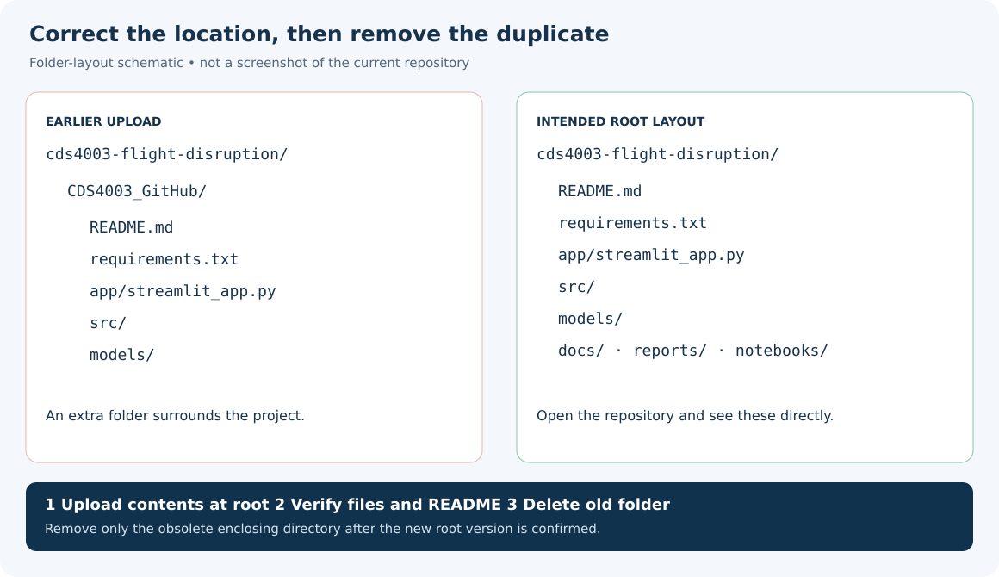

# GitHub update guide: replace the project and remove the duplicate folder

Use this guide to update [Celestica19/cds4003-flight-disruption](https://github.com/Celestica19/cds4003-flight-disruption). The goal is one project at the repository root, with the latest README and supporting documentation. Earlier commits remain in Git history.

The diagram below shows the intended folder correction. It is a **schematic**, not a screenshot or proof that the repository has already been changed.



*Figure G1. Upload the project contents to the root first. After checking the uploaded files, remove the obsolete nested copy.*

## Before you start

Have the latest `CDS4003_GitHub_Upload_Ready.zip` downloaded and sign in to GitHub as the repository owner. Use the browser-upload edition, which excludes the large row-level prediction export. Keep the full analysis archive on your computer for reproducibility.

Your earlier screenshot showed a root folder named `CDS4003_GitHub`. If that folder has already been removed, skip its deletion. If the root already contains project files, upload the revised files at those same paths to update them.

## Step 1 — Extract the latest package into a fresh local folder

1. In Windows Downloads, locate the latest ZIP by download time.
2. Right-click it and choose **Extract All**.
3. Choose a new destination so the revised files are easy to distinguish from an older extraction.
4. Open the extracted folder. Continue opening any enclosing folder until `README.md`, `requirements.txt`, `app`, `src` and `models` appear together.

Windows may display `requirements` without the `.txt` extension. Its type should be a text document. Leave the filename unchanged.

**Checkpoint:** you are looking at the actual project contents. A directory that contains only one other project folder is one level too high.

## Step 2 — Start the upload from the repository root

Open the repository's main **Code** page and check the branch is `main`. The breadcrumb should show the repository name without an extra project folder.

Select **Add file → Upload files**. In File Explorer, select all the project contents from Step 1 and drag them into the upload area. This keeps subfolders together and places the root files correctly. Wait until the upload list finishes populating.

**Checkpoint:** expected paths include:

| Correct path | What it establishes |
|---|---|
| `README.md` | The project overview will appear on the repository's main page |
| `requirements.txt` | Dependencies are available at the expected root |
| `app/streamlit_app.py` | The deployment entry point matches the guide |
| `src/features.py` | The shared feature implementation is present |
| `models/model.joblib` | The trained artifact is included |
| `docs/project_walkthrough.md` | The detailed analysis guide is included |
| `docs/github_update_guide.md` | This update guide is included |

If the upload paths instead begin `CDS4003_GitHub/...` or `CDS4003_GitHub_Upload_Ready/...`, return to the local project contents and repeat the selection. Do not commit an enclosing folder as the new root layout.

## Step 3 — Commit the revised files

Use a meaningful message such as:

```text
Expand project documentation and place files at repository root
```

Commit the changes. If your repository allows a direct commit to `main`, that completes this upload. If GitHub offers a new branch and **Propose changes**, create the pull request and merge it into `main` before continuing. An unmerged branch does not change the files shown on `main`.

The root upload updates files at matching paths. It does not automatically remove a separate nested directory.

## Step 4 — Verify the new version before deleting anything

Return to the repository's main page and refresh it. Make these checks:

| Check | Expected result |
|---|---|
| Root file list | `app`, `src`, `models`, `notebooks`, `docs`, `reports` and root files are visible directly |
| README title | “Flight Disruption Prediction and Passenger-Support Planning” |
| README navigation | Links to the detailed project walkthrough and GitHub guide |
| README visuals | Workflow, temporal split and selected analysis charts render |
| Application path | Opening `app` shows `streamlit_app.py` |
| Model files | `model.joblib`, `metadata.json` and `lookups.json` are present |
| New guide | `docs/project_walkthrough.md` opens and shows all numbered stages |

If only the old folder appears, you may still be viewing the earlier commit, a different branch, or an upload that has not been merged. Resolve that before deletion.

## Step 5 — Delete only the obsolete nested copy

After Step 4 passes, open the old `CDS4003_GitHub` directory from the root. In its directory view, use the **…** menu and choose **Delete directory**. Review the deletion list: every removed path should begin `CDS4003_GitHub/`.

Use this commit message:

```text
Remove obsolete nested project copy
```

Commit, or merge the deletion pull request if using a branch. Return to the main page and verify that the new root files remain and the old nested folder is gone.

**Do not select a root project directory such as `app`, `src` or `models` for this cleanup.** The duplicate to remove is the enclosing old project folder identified in your earlier screenshot.

## Step 6 — Confirm the final repository

The final root should contain these 14 items:

| Files | Folders |
|---|---|
| `.gitignore` | `app/` |
| `config.json` | `data/` |
| `README.md` | `docs/` |
| `requirements.txt` | `models/` |
| `requirements-dev.txt` | `notebooks/` |
|  | `reports/` |
|  | `scripts/` |
|  | `src/` |
|  | `tests/` |

Some empty local data directories may not appear in Git unless a placeholder file is included. The populated sample directory should appear.

Check the repository in a signed-out/private browser window to confirm public visibility. Open a notebook, a chart and the model metadata. The old files can still be viewed through earlier commits; deleting the directory changes the current project, not its historical record.

## Step 7 — Move to deployment after the repository check

Use the same repository in [Streamlit Community Cloud](https://share.streamlit.io/):

| Deployment field | Value |
|---|---|
| Repository | `Celestica19/cds4003-flight-disruption` |
| Branch | `main` |
| Main file path | `app/streamlit_app.py` |
| Python version | 3.12 |

The full launch, acceptance-check and troubleshooting instructions are in [run_and_deploy.md](run_and_deploy.md). A live URL should be added only after the application works and is accessible without the owner's login.

## Troubleshooting

| Symptom | Likely explanation | Next action |
|---|---|---|
| GitHub displays “Add a README” | README is nested or not on the displayed branch | Inspect the root and branch; upload `README.md` at the root |
| One enclosing project folder appears again | The folder itself was dragged instead of its contents | Open it locally, select the contents, and upload those at the root |
| Revised README is not visible | Old extraction, uncommitted upload or unmerged branch | Check download time, latest commit and branch |
| Delete-directory option is absent | Wrong view, no write permission or branch restrictions | Open the old directory itself while signed in as owner; inspect the menu |
| Images appear broken | Referenced image files or paths are missing | Verify `reports/figures/` and `docs/figures/` were uploaded |
| File-size warning | Full archive or large prediction export was selected | Use the browser-upload edition |
| Upload exceeds 100 files | Extra files from another extraction were included | Use the verified package contents only; split uploads if adding your own files |
| A useful root file was removed | Incorrect deletion selection | Recover its contents from the prior commit and make a corrective commit |

## Official interface references

- [Upload files to a repository](https://docs.github.com/en/repositories/working-with-files/managing-files/adding-a-file-to-a-repository)
- [Delete a file or directory](https://docs.github.com/en/repositories/working-with-files/managing-files/deleting-files-in-a-repository)
- [Deploy on Streamlit Community Cloud](https://docs.streamlit.io/deploy/streamlit-community-cloud/deploy-your-app/deploy)

Interface wording can vary with permissions and branch settings. These instructions describe the expected workflow; no live repository mutation has been performed by this guide.

