# Technical walkthrough: from flight records to a review queue

This guide explains the implemented pipeline, the purpose of each step, the artifacts to inspect and the meaning of the recorded results. It accompanies the executable code and six notebooks. Commands assume the current working directory is the repository root.

## 1. Define the decision before building the model

**Decision:** which scheduled flights should receive additional passenger-support review when staff can review only a limited fraction of the schedule?

**Prediction point:** before departure, using planned schedule fields. Actual departure delay, actual arrival time, delay causes and cancellation outcomes are unavailable at this point and are excluded from the predictor allowlist.

**Target:** cancellation OR diversion OR arrival delay of at least 15 minutes. Valid cancellation/diversion flags are required. When neither event occurs, arrival delay must be observed to assign a label. Contradictory flags or unknown targets would be quarantined; neither caused a quarantine in the supplied run.

**Expected output:** an imperfect probability estimate and a priority decision. A high score is a reason to review a flight, not evidence that it will certainly be disrupted. The 10% workload and 1:5 relative error-cost ratio are modelling assumptions that would need stakeholder agreement.

**Success checks:** compare chronological CV average precision with the prevalence baseline, then measure precision, recall and lift at 10% capacity on the final November–December holdout. The proposed lift target is 1.25×; observed lift is 1.604×. A controlled intervention study would be needed to establish actual service improvement.

## 2. Acquire the original data and establish provenance

The source is [US DOT 2015 Flight Delays and Cancellations on Kaggle](https://www.kaggle.com/datasets/usdot/flight-delays), distributed under CC0: Public Domain. The original archive was supplied by the project owner.

Use one acquisition route:

```bash
python scripts/download_data.py
```

Or import an existing archive:

```bash
python scripts/download_data.py --archive /path/to/flight-delays.zip
```

The acquisition script extracts the source CSVs and records source checksums. The main file is `data/raw/flights.csv`; the two lookup files describe airline and airport names. Full data is excluded from Git because a repository should contain the reproducible procedure and a manageable sample.

A SHA256 hash identifies the exact file bytes. Matching row counts alone cannot establish that two files contain the same records. The source-flight checksum recorded for this run is:

```text
afa4e42188b113dd69427a3fbd00a4b6979c6235c866f963c2899d18a3403a83
```

The independent count and preparation audit agree on **5,819,079 rows and 31 columns**. A five-row preview or the 1,000-row repository sample is useful for understanding the schema but does not verify full-source scale.

**Inspect:** [source manifest](../reports/download_manifest.json), [independent checks](../reports/independent_source_checks.json), [data dictionary](data_dictionary.csv) and [dataset-search record](dataset_search.csv).

## 3. Audit and prepare all source records

```bash
python scripts/prepare_data.py
```

Preparation reads chunks of 100,000 rows. Chunking reduces peak memory use. A SQLite index tracks row hashes across the entire file, so duplicate checks continue across chunk boundaries rather than resetting for each chunk.

### 3.1 Standardize representations before interpreting values

The cleaner trims whitespace, normalizes missing tokens and uppercases categorical codes. It converts numerical fields with explicit error handling and records invalid conversions. Invalid finite-domain values become missing rather than silently remaining usable numbers. All counters are exported, including zeros: a check with no changes is still evidence that the rule was applied.

The observed run found no malformed numeric values or invalid clock/domain values. These are implemented safeguards, not problems claimed to have occurred in this source.

### 3.2 Separate missing predictors from structural missing outcomes

Three different situations require different decisions:

| Situation | Treatment | Why |
|---|---|---|
| A cancelled flight lacks arrival delay | Use the known cancellation event to assign a positive target; retain absent arrival delay | The flight did not complete a normal arrival; absence is meaningful. |
| A noncancelled, nondiverted flight has an unknown arrival outcome | Quarantine instead of inventing a label | The target cannot be established reliably. |
| A usable record lacks a numerical schedule predictor | Fit median imputation on the training side of the pipeline | The known outcome can remain useful without using holdout statistics. |

There are **105,071** missing arrival-delay values. The source contains **89,884 cancellations** and **15,187 diversions**; their sum matches that missing-outcome count in this dataset. This relationship is an observed property of the supplied source, not a universal assumption for flight data.

Only six scheduled-duration values are missing in the training inputs. The final fitted training median is **122 minutes**. Numerical imputation leaves zero missing numerical model inputs across the full training partition. This does not imply that every missing field in the audit dataset should be filled.

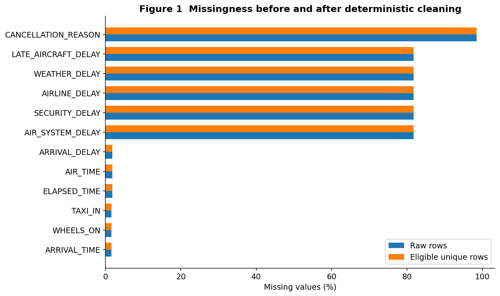

*Figure 1. Missingness across source fields. Cause and outcome fields can be structurally absent. In this run raw and eligible row counts are equal; the audit uses separate denominators so they can differ in other runs.*

### 3.3 Distinguish duplicates from repeated identifiers

An exact duplicate repeats all original fields and is identified through a full-row hash. A repeated business key with different field values requires investigation; arbitrarily retaining the first row could remove a legitimate event or preserve an incorrect one.

The observed counts are **zero exact duplicates** and **zero conflicting business keys**. No duplicate removal is claimed. The implementation remains useful for detecting such records in another source version.

### 3.4 Handle mixed airport identifiers without guessing

October contains 486,165 numeric origin identifiers and 486,165 numeric destination identifiers. These are preserved as `BTS_<five-digit ID>` when a verified crosswalk is unavailable.

This provides an unambiguous representation but **does not reconcile the airport identities**. A verified historical mapping can be supplied in `data/raw/airport_id_to_iata.csv` with columns `airport_id,iata_code`. Ambiguous IDs or malformed mappings are rejected.

The issue matters because the training period uses IATA categories, while October introduces a different identifier namespace during validation. September validation AP is 0.201744 and October AP is 0.163327. Month and code format change together, so this difference cannot isolate the identifier issue as the cause.

### 3.5 Interpret clock values and outliers in context

HHMM values must represent valid hours and minutes, with `2400` explicitly accepted as midnight. Feature conversion maps it to zero minutes; a scheduled departure of 2400 also advances calendar-derived features to the next day. Two scheduled arrival values use this convention in the source.

Negative arrival delays represent early arrivals. The cleaner retains **3,500,899** such records and **32** arrival delays exceeding 1,440 minutes. Large positive values are relevant disruption outcomes. Train-sample IQR diagnostics identify values for review but do not automatically delete them.

### 3.6 Reconcile the complete dataset

The following accounting must hold:

`raw rows = exact duplicates removed + quarantined rows + eligible rows`

For the supplied run: **5,819,079 = 0 + 0 + 5,819,079**.

Eligible rows are then assigned to training, validation, test or embargo partitions. All eligible rows are accounted for; embargo rows are preserved separately.

**Inspect:** [quality audit](../reports/quality_audit.json), [missingness comparison](../reports/missingness_before_after.csv), [imputation table](../reports/model_input_imputation.csv), [outlier review](../reports/outlier_review.csv) and [integrity validation](../reports/data_integrity_validation.json).

## 4. Explore patterns without using test outcomes for development

Exploratory outcome summaries use training data. Carrier, departure-hour and daily rates are exact training aggregates. The arrival-delay distribution and IQR diagnostics use a reproducible 100,000-row training sample.

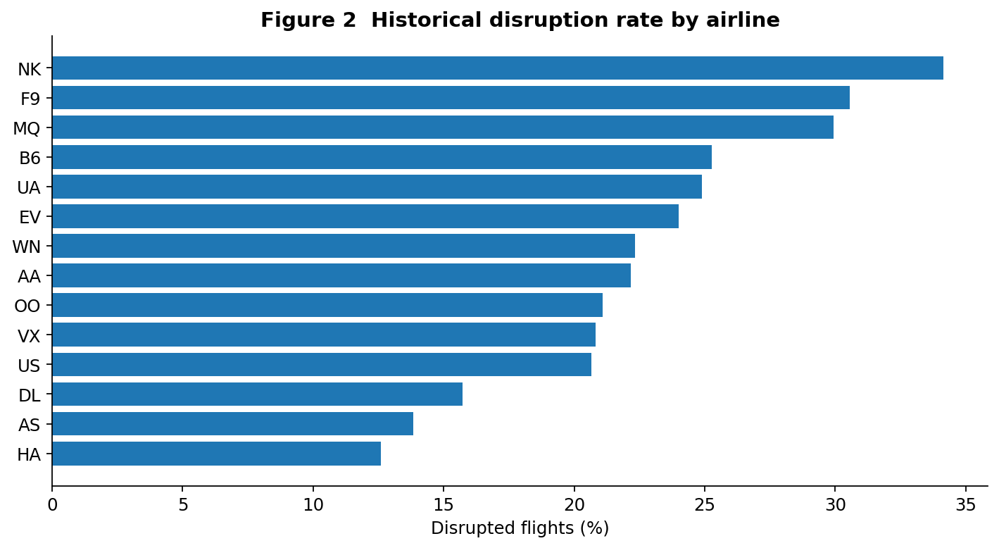

*Figure 2. Carrier disruption rates in the training period. Read the sample sizes and consider route composition before comparing carriers. These are descriptive associations.*

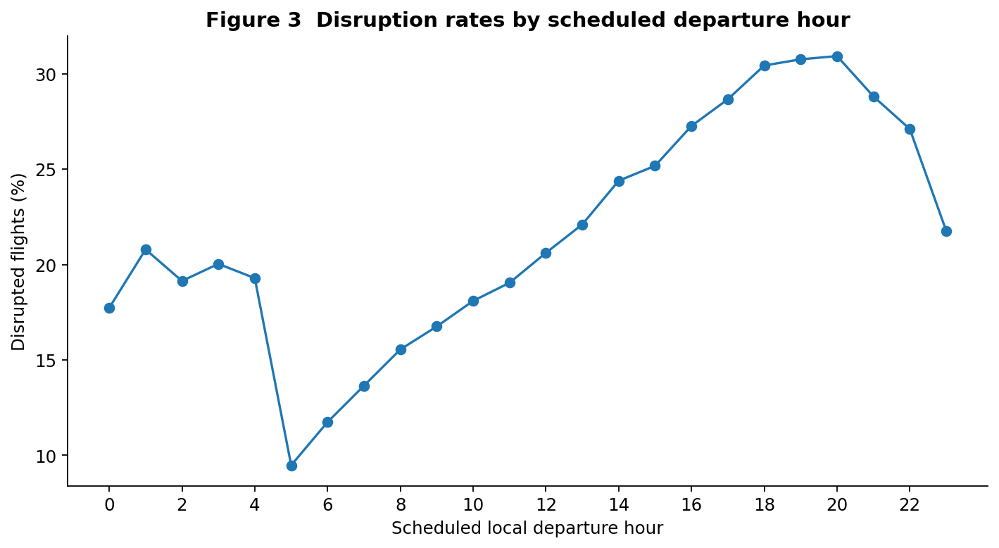

*Figure 3. Training disruption rates rise from 11.74% for departures at 06:00–06:59 to 30.93% at 20:00–20:59. This supports examining schedule-related prioritization; it does not establish the cause of the increase.*

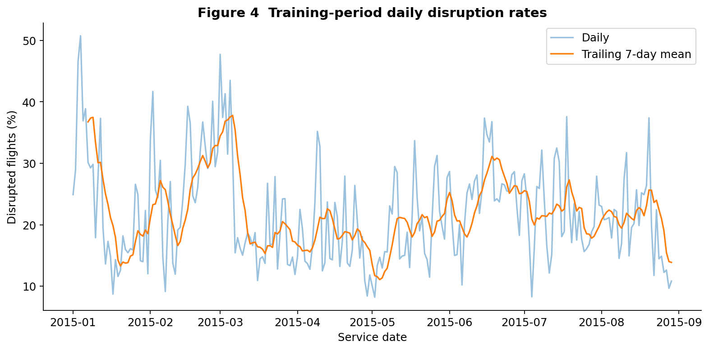

*Figure 4. Exact daily training aggregates. The rolling line summarizes the preceding seven dates and is descriptive, not a model input.*

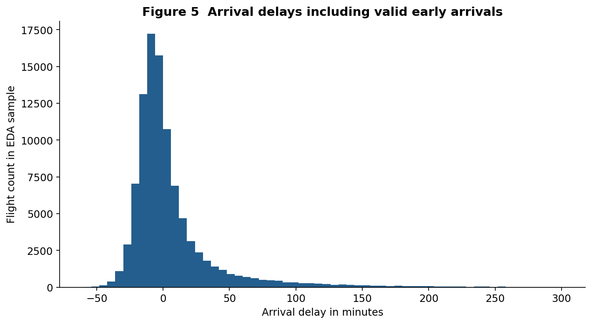

*Figure 5. A 100,000-row training sample. The display spans −60 to 300 minutes. The 194 nonmissing sampled observations outside the display remain in the dataset.*

A useful interpretation has three parts: identify the visible pattern, state the evidence supporting it, and explain a plausible business implication while acknowledging confounding. For example, time-related patterns can motivate schedule features without asserting that departing later causes disruption.

## 5. Construct predictors available before departure

`src/features.py` uses an explicit allowlist. Modifying a delay-outcome column cannot change model inputs. This is stronger than dropping a few known leakage columns while accidentally leaving another outcome proxy.

| Feature family | Construction | Intended information |
|---|---|---|
| Local scheduled clocks | HHMM to minutes since midnight | Within-day schedule patterns |
| Calendar | Month and weekday from service date, with midnight handling | Seasonal and weekly variation |
| Carrier and airports | Normalized airline, origin and destination codes | Carrier and network differences |
| Scale and duration | Distance in miles; scheduled duration in minutes | Planned journey characteristics |
| Cyclic extensions | Sine and cosine with periods of 1,440 minutes, seven weekdays or 12 months | Smooth representation near the end/start of a cycle |
| Operational proxies | Weekend, departure at/after 20:00, log distance, scheduled miles/hour | Candidate nonlinear summaries |
| Route and identifier flags | Origin–destination pair; numeric-ID flags | Route context and identifier format |

For a cyclic value `x` with period `P`, the pair is `sin(2πx/P)` and `cos(2πx/P)`. This places 23:59 near 00:00 in cyclic space. The duration proxy is `60 × distance / scheduled duration`; it is not measured airspeed. Arrival and departure local clocks are not subtracted to infer duration because their time zones can differ.

The final base model uses **six numerical and three categorical features**. Extra engineered features are evaluated rather than presumed beneficial.

**Inspect:** [feature code](../src/features.py), [schema](../src/schema.py) and [ablation results](../reports/feature_ablation.json).

## 6. Separate development, validation and final evaluation

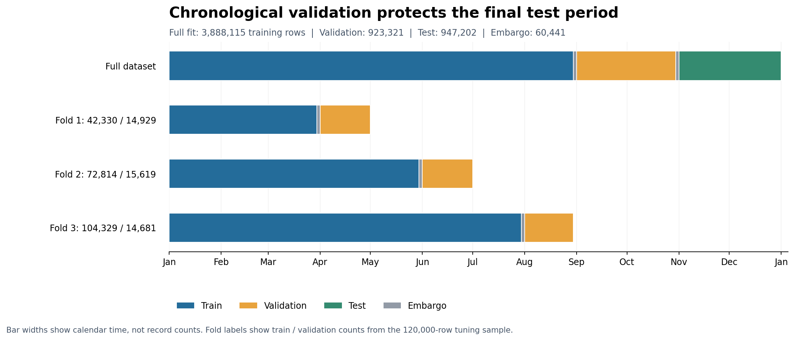

*Figure 6. Calendar windows for the full-data partitions and the training-only tuning folds. Bar widths represent time, not record counts. Counts on CV rows refer to the 120,000-row tuning sample.*

| Partition | Dates | Rows |
|---|---|---:|
| Training | 1 January–29 August | 3,888,115 |
| Validation | 1 September–29 October | 923,321 |
| Test | 1 November–31 December | 947,202 |
| Embargo | 30–31 August and 30–31 October | 60,441 |
| Total | 2015 source coverage | 5,819,079 |

Temporal separation approximates predicting later flights from earlier flights. A random split could mix the same seasonal or operational conditions across development and evaluation. A two-day embargo limits immediate adjacency; it does not prove full independence.

The fixed-seed tuning sample has 120,000 training-period records. Within that sample:

| Fold | Training window | Training rows | Validation window | Validation rows |
|---|---|---:|---|---:|
| 1 | 1 January–29 March | 42,330 | 1–30 April | 14,929 |
| 2 | 1 January–29 May | 72,814 | 1–30 June | 15,619 |
| 3 | 1 January–29 July | 104,329 | 1–29 August | 14,681 |

Fold 3 ends on 29 August because the outer training partition ends there. The final model is refitted on 3,888,115 training records, not just the tuning sample.

Preprocessing is fitted separately inside each fold. Numerical medians, scaling statistics, category groupings and model parameters cannot learn from that fold's validation rows.

## 7. Compare, tune and select the model

### 7.1 Understand each candidate

**Prevalence baseline:** assigns the training disruption rate to every flight. It checks whether schedule information adds discrimination. Constant scores contain no meaningful ranking; outcome-independent tie handling is required for ranking metrics.

**Logistic regression with SGD:** fits a linear score through logistic loss and converts it to a probability estimate. SGD supports large training sets. Numerical scaling improves optimization, one-hot encoding avoids assigning artificial numeric order to categories, and regularization controls coefficient complexity. Nonlinear behaviour depends on supplied feature transformations.

**Histogram gradient boosting:** fits successive decision trees that improve prediction loss. Histogram binning improves computational efficiency. Numerical inputs are median-imputed; categories are ordinal-encoded for native categorical handling, not treated as continuous ordered measurements. Unknown categories become missing. Each encoded categorical feature is limited to 128 categories with infrequent grouping.

Early stopping is disabled so neither model silently creates a random internal validation split.

### 7.2 Search a documented parameter space

| Model | Parameter | Candidate values |
|---|---|---|
| Logistic SGD | Regularization strength, alpha | 0.00001, 0.0001, 0.001, 0.01 |
| Logistic SGD | Class weight | None, balanced |
| Logistic SGD | Penalty | L2, elastic net |
| Histogram boosting | Learning rate | 0.04, 0.08, 0.12 |
| Histogram boosting | Maximum leaf nodes | 15, 31, 63 |
| Histogram boosting | L2 regularization | 0, 1, 10 |
| Histogram boosting | Minimum samples per leaf | 30, 100 |

Six randomized candidate configurations are evaluated per nonbaseline family on three temporal folds. This is a computationally bounded search, not an exhaustive search. Seed 42 controls sampling and search reproducibility.

| Model | CV AP before tuning | CV AP after tuning |
|---|---:|---:|
| Baseline | 0.211544 | 0.211544 |
| Logistic SGD | 0.289323 | 0.302078 |
| Histogram boosting | 0.301569 | 0.307678 |

The selected boosting settings are learning rate 0.04, maximum 15 leaf nodes, minimum 100 samples per leaf and L2 regularization 1.0. The estimator uses 150 boosting iterations.

### 7.3 Check whether engineered features add value

The winning family is evaluated with base and extended features, retaining the same classifier settings and folds. Mean base-feature AP is 0.308064, compared with 0.307678 for the extended set. The base model is selected.

This small difference is evidence against assuming the extensions help in this run. It does not establish a statistically significant advantage, and the alternatives are not independently retuned during ablation.

### 7.4 Freeze the individual-flight threshold

Validation scores determine a threshold under the assumed 10% workload budget. This procedure uses score distribution, not validation outcome labels, to set capacity. Ties that would exceed capacity are excluded. The final threshold is **0.32787811995956606**.

The family comparison table contains validation diagnostics for the original extended-feature candidates. The final base-feature validation results are in `final_validation_metrics.json`. These values should not be mixed as though they described one identical model.

Only after model, features and threshold are fixed does the training script load the test partition for scoring.

## 8. Evaluate prediction quality and practical trade-offs

### 8.1 Read the metrics in context

| Metric | Question it answers | Recorded selected-model result |
|---|---|---:|
| Average precision | How well does the ranking retain precision as recall increases? | 0.266330 |
| ROC AUC | How well are positive and negative cases ranked relative to each other? | 0.617095 |
| Brier score | How close are probability estimates to binary outcomes on average? Lower is better. | 0.152572 |
| Log loss | How strongly are incorrect confident probabilities penalized? Lower is better. | 0.479465 |
| Precision at 10% | What fraction of the review queue is disrupted? | 30.89% |
| Recall at 10% | What fraction of all disruptions enters the review queue? | 16.04% |
| Lift at 10% | How concentrated is disruption relative to the overall test rate? | 1.604× |

Average precision summarizes precision across changes in recall; it is not the same calculation as a trapezoidal area beneath a plotted precision–recall curve. ROC AUC should be interpreted with prevalence and workload, rather than used alone to describe practical usefulness.

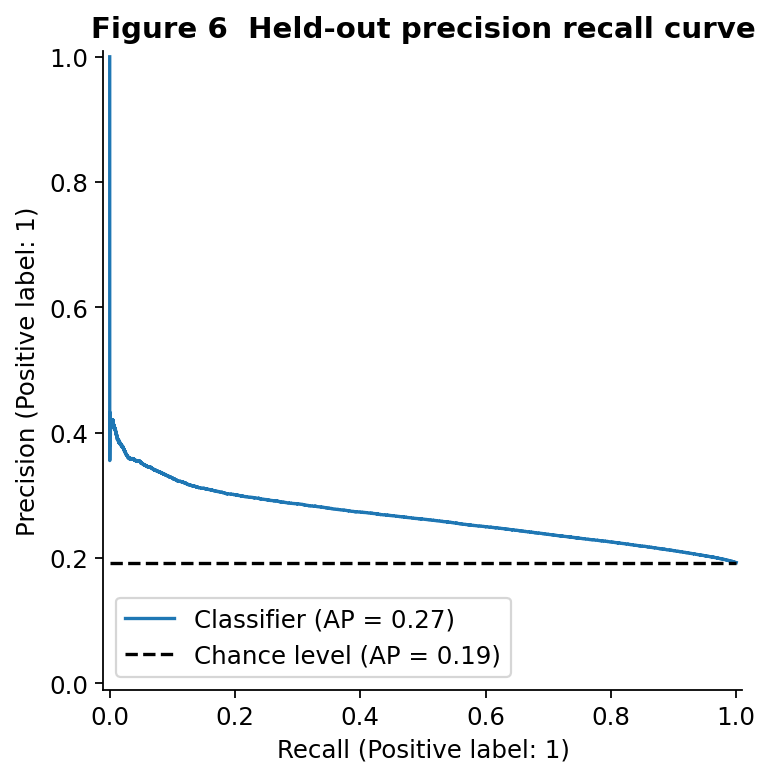

*Figure 7. Held-out precision–recall behaviour. The test disruption prevalence is 19.26%, compared with model average precision of 0.2663.*

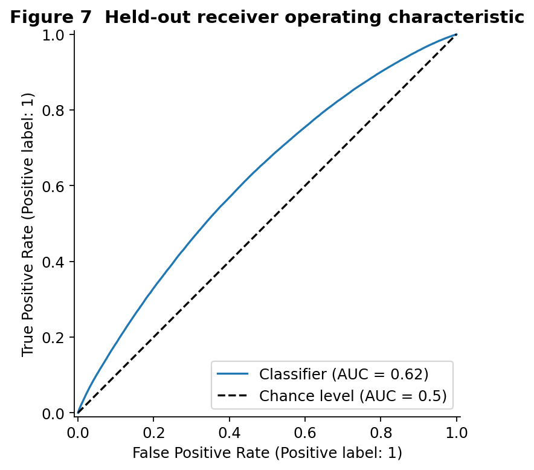

*Figure 8. ROC performance complements the precision–recall view. AUC of 0.6171 indicates modest discrimination.*

### 8.2 Separate a score threshold from a review budget

| Policy | Individual decision | Test workload | Interpretation |
|---|---|---:|---|
| Frozen threshold | Review when probability ≥ 0.327878 | 12.19% of flights | Stable score rule, variable workload |
| Top-10% ranking | Review the highest-ranked floor(0.10 × N) flights | 94,720 of 947,202 | Fixed workload, ranking-based selection |

At the fixed threshold, the test confusion counts are:

| Actual outcome | No alert | Alert |
|---|---:|---:|
| Not disrupted | 684,186 true negatives | 80,555 false positives |
| Disrupted | 147,579 false negatives | 34,882 true positives |

Threshold precision is **30.22%**, recall **19.12%** and F1 **0.2342**. These differ from the top-10% metrics because the decisions differ.

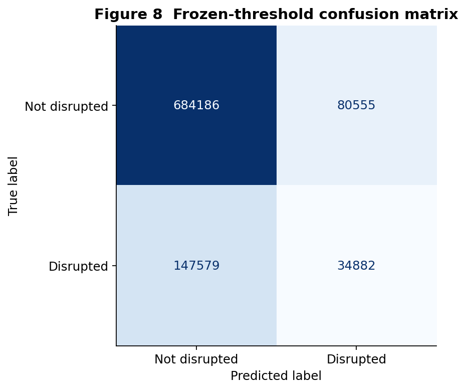

*Figure 9. Counts use the frozen validation threshold. Do not describe them as a top-10% confusion matrix.*

### 8.3 Examine calibration, uncertainty and explanations

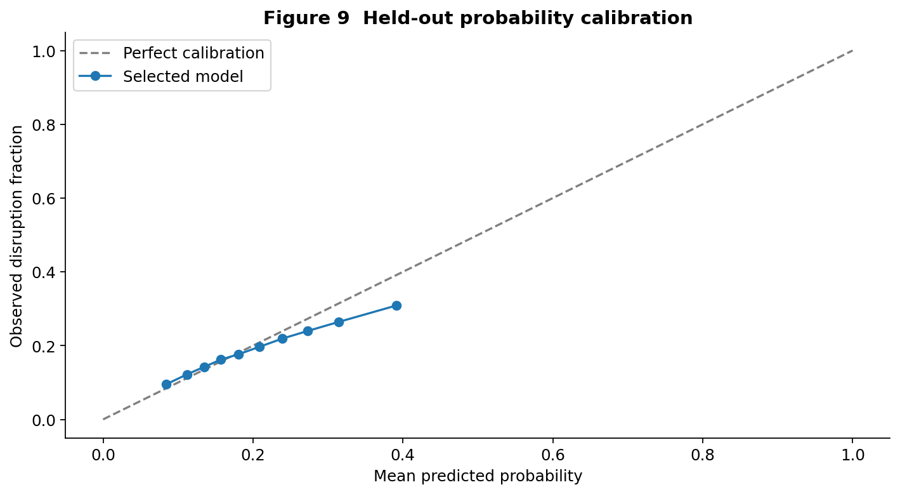

*Figure 10. Quantile-bin calibration compares estimated risk with observed frequency. A displayed probability should not be treated as perfectly calibrated.*

Day-cluster bootstrap intervals resample whole test dates 200 times. The fixed-threshold 95% intervals are **26.98–33.64% for precision** and **17.01–20.95% for recall**. These intervals condition on the fitted model; they do not include uncertainty from training a different model or predicting a new year.

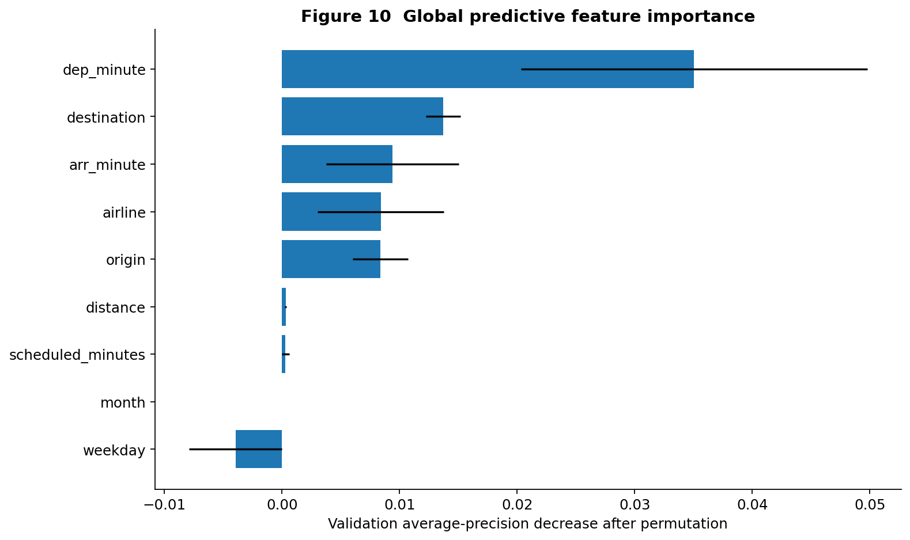

*Figure 11. Importance is the AP decrease after shuffling one feature on a 3,000-row validation sample, repeated three times. Correlated features can share importance; these are global associations.*

Cost sensitivity uses relative units. At the illustrative 1:5 ratio, the fixed-threshold score is **864.07 units per 1,000 test flights**, compared with **963.16** for the baseline's no-alert threshold. The calculation is `1000 × (FP + 5 × FN) / N`. It is not money saved and does not measure whether reviewing an alert prevents a disruption.

### 8.4 Translate the result into a cautious recommendation

The ranking concentrates disruptions in the queue: approximately 31 disrupted flights per 100 reviewed, compared with 19 under baseline selection. Yet around 84% of disruptions remain outside a top-10% queue. A plausible next step is a controlled support-planning pilot using recent validated data, not automatic operational rollout.

## 9. Save and verify the model

The serialized pipeline contains preprocessing and the classifier together. This reduces the risk of using a different transformation during deployment. Metadata records the feature variant, threshold, vocabulary, numeric ranges, source hash, configuration and environment.

The app verifies the model SHA256 and requires status `TRAINED_REAL_DATA`. The checksum detects accidental artifact mismatch; it is not an independent guarantee of model quality or security.

```bash
python scripts/verify_trained_artifact.py
```

This standalone check needs the full `reports/test_predictions.csv.gz` export. Restore it from the complete archive when using the browser-upload edition. The recorded verification checked all training numerical inputs and compared 1,000 persisted predictions with their saved evaluation values.

**Evidence:** [artifact verification](../reports/trained_artifact_validation.json), [software validation](../reports/software_validation.json), [metadata](../models/metadata.json) and [model card](../models/model_card.md).

## 10. Run the application and use the review queue

The application can use the included model without downloading the full data or training again:

```bash
python -m pip install -r requirements.txt
python -m streamlit run app/streamlit_app.py
```

For an individual flight, supply the historical service date, airline, two different airports, local scheduled times, distance and planned duration. After validation, the form converts these inputs to the same feature schema used in training and displays risk plus a threshold-based priority message.

For a batch, upload a CSV with exactly these required fields; extra fields are ignored for modelling:

| Input column | Format or unit |
|---|---|
| flight_date | Valid date in 2015, such as YYYY-MM-DD |
| AIRLINE | Two-character airline code |
| ORIGIN_AIRPORT | Three-letter IATA code or BTS_ followed by five digits |
| DESTINATION_AIRPORT | Same code conventions; different from origin |
| SCHEDULED_DEPARTURE | Local HHMM, with 2400 accepted |
| SCHEDULED_ARRIVAL | Local HHMM, with 2400 accepted |
| SCHEDULED_TIME | Positive finite minutes, within observed training range |
| DISTANCE | Positive finite miles, within observed training range |

The UI accepts 1–50,000 rows and a 1–50% review fraction. Rows are sorted by estimated probability, with stable original-row order for exact ties. The selected count is `floor(N × review_fraction)`; a tiny batch can therefore select zero rows. Unknown training codes are flagged for review.

The offline evaluation uses fixed-seed random tie-breaking, whereas the app preserves input order for ties. These are both label-independent but can choose different flights when scores tie; the app does not promise to reproduce exact holdout queue membership.

Use [app_example.csv](../data/sample/app_example.csv) as a valid starting schedule. The downloadable list includes original row number, probability, rank, review flag and unseen-code flag.

## 11. Publish and verify the application

Follow the [GitHub update guide](github_update_guide.md) first, then the [run and deployment guide](run_and_deploy.md). Use the same repository, branch `main`, entry point `app/streamlit_app.py` and Python 3.12.

A successful dependency build is only one checkpoint. Verify valid predictions, invalid input feedback, batch capacity and CSV download, displayed performance, a cold reload and signed-out public access. Record the actual deployed dependency versions and live URL.

The saved-model and batch functions passed checks independently of Streamlit. The Streamlit runtime and public app have **not yet been verified**.

## 12. Navigate the notebooks and reproduce responsibly

| Notebook | Purpose | Inspect after execution |
|---|---|---|
| 01_dataset_access.ipynb | Source records, dictionary and raw-data preview | Source files and provenance |
| 02_data_quality.ipynb | Full-file cleaning, reconciliation and missingness | Audit counters and partitions |
| 03_eda_and_features.ipynb | Training EDA, outlier diagnostics and feature preview | Five EDA charts and feature schema |
| 04_models_and_tuning.ipynb | Candidate models, searches, temporal folds and ablation | Model comparison and warnings |
| 05_evaluation.ipynb | Frozen holdout and business metrics | Five evaluation charts and subgroup/cost tables |
| 06_deployment_readiness.ipynb | Artifact status, checksum and launch handoff | Verified artifact; UI checks still pending |

The notebooks preserve genuine execution outputs from the completed run. Markdown explanations may be expanded without rerunning unchanged code. Re-executing source-dependent cells requires the full raw or processed files; these are not included in the browser package.

The pipeline protects `test_metrics.json` from accidental overwrite. Reproduction should use a separate working copy with prior run outputs archived. A deliberate correction can use `train_models.py --overwrite` only after documenting the reason and preserving the prior run. Retraining repeatedly to improve the same test score would invalidate its role as an untouched evaluation.

## 13. Operational limitations and improvement plan

| Limitation | Consequence | Proposed next investigation |
|---|---|---|
| Historical 2015 US data | Unknown performance on current operations or other regions | Obtain recent comparable data and rolling temporal backtests |
| Unresolved October IDs | Airport category continuity is incomplete | Validate a historically appropriate crosswalk |
| Schedule-only predictors | Weather and real-time network effects are missing | Evaluate additional features available at prediction time |
| Imperfect calibration | Displayed probabilities may differ from observed frequencies | Use a separate temporal calibration period |
| Limited review capacity | Most disruptions remain unreviewed | Compare capacities and intervention costs with stakeholders |
| Composite target | Severity and intervention needs differ | Evaluate cancellation, diversion and delay subgroups |
| No intervention outcomes | Predictive lift cannot establish ROI | Run a controlled support-planning pilot |

A future monitoring plan should record input validity, missingness, new codes, score distributions, queue size, review completion, observed disruption rates and delayed performance. Assign owners and thresholds using real stakeholder requirements. Monitoring, automatic retraining and intervention evaluation are proposals, not implemented services.

