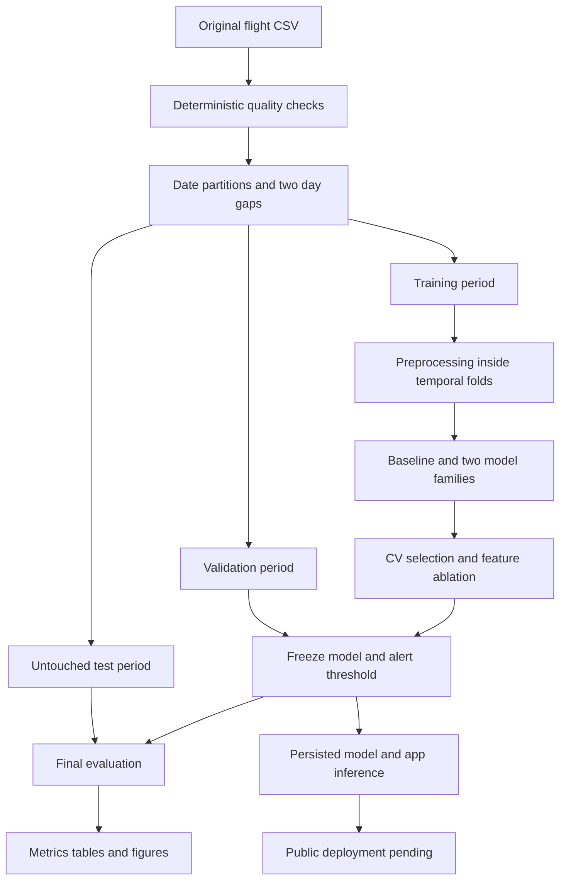

# Workflow, data boundaries and evidence

Missing numerical predictors are imputed using training-only medians. Category encoders, scaling and model fitting are also confined to the training side of each fold. The validation period selects the alert threshold. Test labels do not choose models, hyperparameters, feature variants or thresholds.

The diagram describes the implemented flow and its decision boundaries. Deployment is a separate execution checkpoint. For every stage, commands, artifacts and interpretation are explained in the [technical walkthrough](project_walkthrough.md).

## Reading the branches

The three date partitions serve different roles. Training selects the estimator and feature variant. Validation scores determine an individual-flight cutoff under the workload assumption. Test data measures the frozen decisions. The test partition does not flow back into feature or hyperparameter selection.

The saved pipeline contains both preprocessing and the classifier. The app uses this same artifact for individual and batch inference. Batch ranking controls review count without modifying the learned model.

## Verification boundaries

| Evidence | Establishes | Does not establish |
|---|---|---|
| Full-source hash/count reconciliation | The recorded source and row accounting are consistent | The data is applicable to current operations |
| Temporal CV and ablation | The documented candidates were compared on development periods | A universal best model or significant feature advantage |
| Frozen holdout metrics | Performance on the November–December test period | Realized savings or intervention benefit |
| Saved-model prediction comparison | Serialization preserves the checked predictions | Streamlit UI execution |
| Batch-capacity check | The tested queue size matches its capacity | Public availability of the web app |
| Future signed-out app check | Public accessibility at the time checked | Ongoing production reliability |
